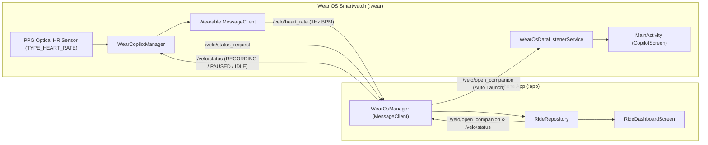

# Wear OS Companion App Roadmap & Architecture

This document outlines the architecture, implementation milestones, and future enhancements for the dedicated Velo Wear OS companion app.

---

## 1. Overview & Current Status

- **Status**: ✅ **Implemented, Verified & Deployed Live**
- **Tested Hardware**: Google Pixel Watch 3 paired with Google Pixel 9 Pro Fold over Wearable Data Layer.
- **Key Capabilities**:
  - **Shared Application ID**: Both handheld and watch modules use `com.velo.app` for seamless Wearable Data Layer routing and unified Play Store delivery.
  - **Auto-Launch Companion**: Starting a ride recording on the phone automatically wakes up and launches the companion app on the watch via background `WearableListenerService` and full-screen intents.
  - **Real-Time Optical PPG Heart Rate**: Captures live BPM from optical wrist PPG sensors and streams over `/velo/heart_rate` at 1Hz directly into the phone app's telemetry pipeline.
  - **Minimalist OLED Cockpit**: True pitch-black (`#000000`) background with Wear OS 6 standard Roboto Flex typography displaying live time and an 11dp three-state status dot:
    - 🟢 **Connected** (Ride active / idle in sync with phone)
    - 🟡 **Paused** (Ride paused)
    - 🔴 **Not Connected** (Disconnected / searching)

---

## 2. Architecture & Data Flow

---

## 3. Implementation Milestones

### Phase 1: Architecture & Dependencies ✅
- Added `:wear` module in `settings.gradle.kts` targeting compileSdk 35 / minSdk 30.
- Unified application ID `com.velo.app` across `:app` and `:wear` modules.
- Added Wear Compose Material 3 (`1.0.0-alpha30`) and Play Services Wearable (`19.0.0`).

### Phase 2: Sensor Access & Heart Rate Streaming ✅
- Configured permissions: `BODY_SENSORS`, `health.READ_HEART_RATE`, `WAKE_LOCK`, `POST_NOTIFICATIONS`, `USE_FULL_SCREEN_INTENT`.
- Implemented runtime permission flows in `MainActivity.kt`.
- Continuous 1Hz optical PPG measurement via `SensorManager.TYPE_HEART_RATE`.
- Binary 4-byte big-endian BPM transmission over `/velo/heart_rate`.

### Phase 3: Bi-Directional Wearable Data Layer Sync ✅
- Implemented `WearOsManager` on phone and `WearCopilotManager` on watch.
- Two-way status synchronization:
  - Phone broadcasts `/velo/status` (`RECORDING`, `PAUSED`, `IDLE`, `FINISHED`).
  - Watch requests status on connection via `/velo/status_request`.
- Auto-wake companion app:
  - Phone sends `/velo/open_companion` and `RECORDING` on ride start.
  - Background `WearOsDataListenerService` launches `MainActivity` with high-priority full-screen intent.

### Phase 4: Pitch-Black OLED UI ✅
- Strict `#000000` background for maximum battery efficiency on circular OLED displays.
- Roboto Flex variable font numerals with cached font families per `compose-oled-ui` best practices.
- Centered layout with three-state status dot (🟢 Green, 🟡 Yellow, 🔴 Red).

---

## 4. Next Roadmap Enhancements

- [ ] **Ambient Mode Support (`AmbientLifecycleObserver`)**: Dimmed low-bit rendering at 10-second refresh intervals when the wrist drops while keeping optical heart rate sampling active.
- [ ] **Wear OS Tiles & Complications**: Quick-start tile on the watch carousel to launch a ride and view weekly cycling stats.
- [ ] **Haptic Alerts**: Gentle wrist vibration cues for heart rate zone thresholds (e.g. entering Peak Zone) or auto-pause detection.
- [ ] **Standalone Watch Recording**: Fallback offline GPS / HR recording when cycling without a phone, with automatic sync upon reconnection.
